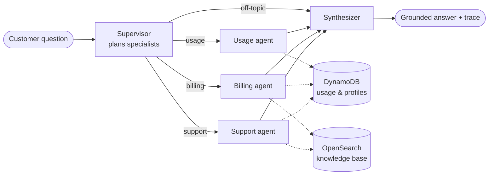

# Bedrock Supervisor Agents

**A supervisor multi-agent assistant for an electricity utility, built on LangGraph and Amazon Bedrock.** A supervisor reads the customer's question, sends it to the right specialists (usage, billing, support), runs them in parallel, and merges their answers into one grounded reply.


---

## What it does

```text
$ energy-agents --customer C1001 --trace "Why was my bill so much higher this month?"

# example output: the figures are computed in code, the wording varies by model
Your September bill is ₹1,770.27, ₹582.82 more than August. You used 274 units against 199,
and the extra usage pushed 74 units into the top slab at ₹7.15 per unit...

[{"node": "supervisor", "plan": ["billing", "usage"]}, {"node": "billing", ...}, ...]
```

Compound questions fan out. *"Why is my bill high, and is there an outage in my area?"* runs the billing and support agents in the same step and returns a single answer.

## Architecture



| Component | Responsibility |
|---|---|
| **Supervisor** | LLM router that returns a JSON plan of specialists. Falls back to keyword routing if the output can't be parsed, so customers always get an answer. |
| **Usage agent** | Month-on-month change, 3-month baseline, peak month, annual total |
| **Billing agent** | Slab-by-slab bill breakdown, change since last month, whether usage crossed into a higher slab, and relevant billing policy |
| **Support agent** | Live outage tickets for the customer's area plus knowledge-base retrieval (outages, safety, energy saving, solar) |
| **Synthesizer** | Merges multi-agent answers and passes single-agent answers through unchanged, saving an LLM call |

## Design decisions

- **Code computes, the LLM explains.** Bills, percentages and slab crossings are calculated in `calculations.py` and handed to the model as JSON facts. The model is told to quote numbers exactly, so you get no hallucinated arithmetic.
- **Parallel fan-out through LangGraph.** The supervisor's plan *is* the conditional edge. Specialists picked together run in one super-step, and their results merge through a state reducer.
- **Graceful degradation.** If one specialist throws (a timeout, say), it returns a polite "unavailable" message and the others still answer. An unknown customer is the one exception, and it surfaces as a 404.
- **Swappable backends.** The same protocols cover local JSON or DynamoDB for data, local BM25 or OpenSearch for the knowledge base, and Bedrock or Ollama for the model.
- **Traceable.** Every response carries a trace of which nodes ran, how long each took, and which sources it used.

## Quick start

```bash
git clone https://github.com/husssainY/bedrock-supervisor-agents.git
cd bedrock-supervisor-agents
pip install -e ".[dev]"
```

**With Amazon Bedrock:**

```bash
export BEDROCK_MODEL_ID=<model or inference-profile ID enabled in your account>
export AWS_REGION=us-east-1
energy-agents --customer C1001 "Why was my bill so high this month?"
```

**Fully local with Ollama (no AWS needed):**

```bash
ollama pull qwen2.5:7b
export LLM_PROVIDER=ollama
energy-agents --customer C1002 --trace "Is there an outage in my area, and how can I cut my usage?"
```

Sample customers are `C1001` (Koramangala, high summer usage), `C1002` (Whitefield, rooftop solar, active outage) and `C1003` (Jayanagar).

### Tests

```bash
pytest
```

Tests run offline with a deterministic fake model. They cover routing, parallel fan-out, synthesis, graceful failure, the Lambda handler, the DynamoDB paging logic and the bill arithmetic.

## Configuration

| Variable | Default | Purpose |
|---|---|---|
| `LLM_PROVIDER` | `bedrock` | `bedrock` or `ollama` |
| `BEDROCK_MODEL_ID` | n/a | Any Converse-compatible model |
| `OLLAMA_MODEL` | `qwen2.5:7b` | Local model |
| `DATA_SOURCE` | `local` | `local` or `dynamodb` (+ `DYNAMODB_TABLE`) |
| `KB_SOURCE` | `local` | `local` or `opensearch` (+ `OPENSEARCH_HOST`, `OPENSEARCH_INDEX`) |

The DynamoDB single-table layout is documented in [`src/energy_agents/data.py`](src/energy_agents/data.py).

## Deploying on Lambda

`energy_agents.handler.lambda_handler` serves `POST {"customer_id", "question"}` behind API Gateway and returns the answer, the agents used, and the trace. The compiled graph is cached across warm invocations. Set `DATA_SOURCE=dynamodb` and `KB_SOURCE=opensearch` in production.

## Project structure

```
src/energy_agents/
├── graph.py          # LangGraph: supervisor → parallel specialists → synthesizer
├── agents/
│   ├── supervisor.py # planner + synthesizer
│   ├── usage.py      # consumption specialist
│   ├── billing.py    # billing specialist
│   └── support.py    # outage / service specialist (RAG)
├── calculations.py   # slab billing + usage analytics
├── knowledge.py      # BM25 local KB, OpenSearch KB
├── data.py           # in-memory and DynamoDB repositories
├── llm.py            # Bedrock, Ollama, fake
├── factory.py        # env-driven wiring
├── handler.py        # Lambda / API Gateway
└── cli.py
data/customers.json   # sample customers, tariff, outages
knowledge_base/*.md   # sample policy documents
```

## License

MIT © Mohamed Munavar Hussain Y
